# ExamLens AI — See beyond the answer.

> **AI-Assisted Handwritten Examination Answer Sheet Evaluation Platform for Colleges and Educational Institutions**

[](https://examlens-m4ji.onrender.com/)
[](https://examlens-m4ji.onrender.com/)

[](https://fastapi.tiangolo.com)
[](https://react.dev)
[](https://tailwindcss.com)
[](LICENSE)

---

### 🌐 Official Live Platform
- **Production URL:** [https://examlens-m4ji.onrender.com/](https://examlens-m4ji.onrender.com/)
- **Target Audience:** Universities, Colleges, Academic Faculty & Autonomous Institutions
- **Tagline:** *"See beyond the answer. AI Evaluates. Teacher Verifies. Student Learns."*

---

## 1. Executive Summary

Traditional examinations in colleges and universities are conducted **physically using pen and paper**. While physical writing tests deep conceptual synthesis, manual grading poses severe challenges:
- High grading fatigue leading to subjective evaluation inconsistency.
- Disproportionate teacher hours spent reading handwriting and totaling numerical scores.
- Students receive only a numeric number on their scorecard with zero formative feedback or diagnostic guidance on why marks were lost.

**ExamLens** is an AI-assisted physical examination evaluation SaaS platform built specifically for academic institutions. **ExamLens is NOT an online test-taking platform**; students write exams in classrooms on paper, and professors use ExamLens to digitize scanned scripts, run handwriting OCR with layout recognition, evaluate answers semantically against configured rubrics, audit and override marks with complete final authority, and publish comprehensive learning scorecards to students.

---

## 2. The 19-Step End-to-End Workflow

```mermaid
flowchart TD
    A["1. Teacher defines Exam & Subject"] --> B["2. Upload Question Paper & Rubric Criteria"]
    B --> C["3. Students write Exam physically with Pen & Paper"]
    C --> D["4. Faculty collects physical Answer Scripts"]
    D --> E["5. Answer scripts scanned to PDF/Images"]
    E --> F["6. Batch/Single Upload to ExamLens Digitization Center"]
    F --> G["7. Image Preprocessing (Pillow/OpenCV Contrast, Deskew)"]
    G --> H["8. Modular Handwriting OCR Engine (Azure / Synthetic)"]
    H --> I["9. Answer Segmentation & Boundary Mapping"]
    I --> J["10. Split-View Teacher OCR Verification Workspace"]
    J --> K["11. Teacher Verifies/Corrects Digitized Handwriting"]
    K --> L["12. AI Semantic Evaluation Engine (OpenAI / Mock LLM)"]
    L --> M["13. Structured Criteria Evaluation & Partial Marking"]
    M --> N["14. Teacher Review Console (Split Scan + AI Evidence)"]
    N --> O["15. Teacher Overrides Marks (Original AI Score Preserved)"]
    O --> P["16. Teacher Approves Evaluated Scripts"]
    P --> Q["17. Faculty Publishes Official Results"]
    Q --> R["18. Student Portal reveals Scorecard & Class Rank"]
    R --> S["19. Formative AI Diagnostic Feedback & Weakness Insights"]
```



---

## 3. Core Architectural Pillars

### A. Handwriting OCR Provider Abstraction
ExamLens does not pretend handwriting recognition is trivial or rely on printed-text OCR. It implements a clean provider abstraction:
- **`BaseOCRProvider`**: Interface providing `process_image()`, character/word bounding polygons, and confidence scores.
- **`AzureDocumentIntelligenceProvider`**: Production-ready implementation integrating the **Azure AI Document Intelligence Read API** (`prebuilt-read` model specialized for cursive and print handwriting).
- **`MockOCRProvider`**: High-precision synthetic handwriting provider for testing and transparent demo environments without external cloud credentials.
- **Image Preprocessing**: Deskewing, illumination normalization, and bilateral filtering via **OpenCV** and **Pillow**.

### B. Meaning-Based AI Semantic Evaluation
ExamLens scores meaning, not rigid keyword matching:
- **Pydantic Validation**: Structured JSON responses guaranteeing criteria marks, evidence citations, missing concepts, and confidence metrics.
- **Configurable LLM Provider**: Supports OpenAI models (`gpt-4o`, `gpt-4o-mini`), Google Gemini via OpenAI-compatible endpoints, Anthropic Claude, or local self-hosted inference servers (vLLM / Ollama).
- **Transparent Evidence Quotes**: The AI is instructed to cite verbatim snippets from the student's handwritten answer justifying marks awarded or deducted.

### C. Teacher Final Authority Guarantee
**The teacher always has absolute authority over final grades.**
- When a teacher overrides an AI evaluation, the original AI marks, explanations, and evidence citations are **strictly preserved** in the database.
- An immutable **Audit Trail** (`AuditLog`) records who changed the mark, the previous value, the new value, timestamp, and the mandatory teacher justification.
- Unverified OCR confidence (< 80%) and low AI confidence (< 75%) automatically flag scripts for human review.

### D. Responsible Student Feedback
When examination results are published by faculty:
- Students can log in to their student portal and view their scorecard.
- AI educational feedback is clearly differentiated from faculty commentary with explicit badges.
- Students receive actionable recommendations: **Key Strengths**, **Misconceptions / Missing Concepts**, and **Suggested Revision Topics**.

---

## 4. Technology Stack

### Frontend
- **Framework**: React 18 with TypeScript
- **Build Tool**: Vite 6
- **Styling**: Tailwind CSS with custom academic palette (`#4f46e5` indigo accents, slate neutrals)
- **Icons**: Lucide React
- **Data Visualization**: Recharts (Histograms, Question Difficulty Index, Trend Curves)
- **State & Networking**: Custom typed API client with JWT interception, persistent sessions, and demo role switchers

### Backend
- **Framework**: Python 3.14 / FastAPI
- **Database ORM**: SQLAlchemy 2.0 (configured with SQLite for development; fully PostgreSQL-compatible)
- **Data Validation**: Pydantic v2 schemas
- **Security**: JWT authentication (HMAC-SHA256) with Bcrypt password hashing
- **Image Processing**: OpenCV (`opencv-python`), Pillow (`PIL`), PyMuPDF / `pdf2image`

---

## 5. Repository Structure

```
ExamLens/
├── backend/
│   ├── app/
│   │   ├── api/routes/          # REST route handlers
│   │   │   ├── auth.py          # JWT login, register, current user profile
│   │   │   ├── exams.py         # Exam lifecycle (draft, ready, publish)
│   │   │   ├── questions.py     # Questions & multi-criterion rubrics
│   │   │   ├── scripts.py       # Physical answer script upload & PDF parser
│   │   │   ├── ocr.py           # Handwriting OCR extraction & manual verification
│   │   │   ├── evaluations.py   # AI semantic evaluation trigger
│   │   │   ├── reviews.py       # Teacher mark overrides & audit trail
│   │   │   ├── results.py       # Student portal results & scorecard
│   │   │   ├── analytics.py     # Teacher academic metrics & CSV exports
│   │   │   └── system.py        # Health, OCR provider status, AI status
│   │   ├── core/                # Configuration, JWT security, auth dependencies
│   │   ├── database/            # SQLAlchemy database engine & session
│   │   ├── models/              # Relational models (Exams, Scripts, Evaluations, etc.)
│   │   ├── schemas/             # Pydantic input/output schemas
│   │   └── services/            # OCR engine, AI evaluator, Image Preprocessing
│   ├── examlens.db              # Pre-seeded SQLite database with sample exams & scripts
│   └── test_complete_lifecycle.py # Automated 19-step end-to-end integration test
├── frontend/
│   ├── src/
│   │   ├── components/          # Navbar, Sidebar, Header, AuthModal
│   │   ├── context/             # AuthContext with 1-click demo profiles
│   │   ├── pages/               # 10 production pages
│   │   │   ├── LandingPage.tsx          # Marketing presentation & 5-step workflow
│   │   │   ├── TeacherDashboard.tsx     # 7 KPI cards, recent exams, pending reviews
│   │   │   ├── ExamListPage.tsx         # Curriculum examinations directory
│   │   │   ├── QuestionBuilderPage.tsx  # Rubric editor with sum validation
│   │   │   ├── UploadCenterPage.tsx     # Physical script single & batch upload
│   │   │   ├── OCRVerificationPage.tsx  # Split-screen scan viewer & text editor
│   │   │   ├── EvaluationQueuePage.tsx  # AI batch evaluation launcher
│   │   │   ├── ReviewWorkspacePage.tsx  # Teacher override & audit console
│   │   │   ├── PublishResultsPage.tsx   # Pre-publication checklist & release
│   │   │   ├── TeacherAnalyticsPage.tsx # Score distribution, question difficulty, CSV
│   │   │   ├── StudentDashboard.tsx     # Student portal with rank & results list
│   │   │   ├── StudentExamDetailPage.tsx# Question-by-question scorecard & feedback
│   │   │   └── SettingsPage.tsx         # OCR/AI provider configuration & persona switch
│   │   ├── services/api.ts      # Typed REST API client
│   │   └── types/index.ts       # TypeScript interfaces matching backend models
│   ├── index.html
│   ├── package.json
│   └── vite.config.ts
└── README.md
```

---

## 6. Pre-seeded Demo Accounts

The database comes pre-seeded with realistic course examinations (e.g. *CS302: Operating Systems*), questions with complete multi-tier rubrics, realistic physical answer sheets with handwriting, and evaluation records:

| Role | Name | Email | Password | Details |
|---|---|---|---|---|
| **Faculty / Teacher** | Prof. Rajesh Sharma | `teacher@examlens.edu` | `examlens123` | Computer Science Dept, Evaluation Authority |
| **Student 1** | Aarav Sharma | `stu101@examlens.edu` | `examlens123` | Roll No: `STU-1024`, Score: 14/15 (93%) |
| **Student 2** | Priya Nair | `stu102@examlens.edu` | `examlens123` | Roll No: `STU-1025`, Score: 12/15 (80%) |
| **Student 3** | Rohan Mehta | `stu103@examlens.edu` | `examlens123` | Roll No: `STU-1026`, Score: 10/15 (67%) |
| **Administrator** | Exam Admin NIT | `admin@examlens.edu` | `examlens123` | Institutional Examination Cell |

*Tip: You can switch between any of these accounts with a single click using the persona dropdown in the top navigation header or inside the Settings page.*

---

## 7. Setup & Execution Guide

### Quick Start (Windows 1-Click Launcher)
Simply double-click or run `start.bat` from the project root:
```cmd
start.bat
```
This launcher automatically:
1. Detects Python and Node.js (including portable node-bin).
2. Spawns the FastAPI backend at `http://127.0.0.1:8000`.
3. Spawns the Vite frontend at `http://localhost:5173`.
4. Opens your default web browser to the application landing page.
5. Displays pre-seeded demo login credentials and cleanly terminates both processes when you press any key.

---

### Manual Step-by-Step Setup

#### Prerequisites
- Python 3.10+
- Node.js 18+ and npm

#### 1. Backend Setup
```bash
cd backend

# Create and activate virtual environment (optional)
python -m venv venv
venv\Scripts\activate  # Windows (or source venv/bin/activate on Linux/macOS)

# Install dependencies
pip install fastapi uvicorn sqlalchemy pydantic python-multipart pyjwt passlib bcrypt httpx pillow opencv-python

# Start the API server
python -m uvicorn app.main:app --host 127.0.0.1 --port 8000 --reload
```
The FastAPI backend will start at `http://127.0.0.1:8000`. Interactive OpenAPI documentation is accessible at `http://127.0.0.1:8000/docs`.

#### 2. Frontend Setup
```bash
cd frontend

# Install npm packages
npm install

# Start Vite development server
npm run dev
```
The frontend application will start at `http://localhost:5173`.

---

## 8. Verification & Automated Testing

ExamLens includes an automated 19-step end-to-end integration test validating the entire lifecycle from authentication to CSV export:

```bash
cd backend
python test_complete_lifecycle.py
```

### Verified Test Assertions:
1. `GET /api/system/status`: Confirms OCR and AI provider abstractions.
2. `POST /api/auth/login`: Teacher JWT issuance.
3. `GET /api/exams/{id}/questions`: Rubric criterion weights and reference answers.
4. `GET /api/scripts/{id}/ocr`: Multi-page scan OCR confidence and word layout.
5. `PUT /api/answers/{id}`: Teacher manual handwriting text correction.
6. `POST /api/scripts/{id}/evaluate`: Meaning-based AI evaluation with Pydantic structured output.
7. `POST /api/evaluations/{id}/override`: Teacher grade override preserving original AI score.
8. `GET /api/evaluations/{id}/audit`: Full audit trail verifying who changed what and why.
9. `POST /api/scripts/{id}/approve-all`: Faculty script approval.
10. `POST /api/exams/{id}/publish`: Release examination marks.
11. `GET /api/student/results`: Student access control and scorecard retrieval.
12. `GET /api/analytics/exam/{id}`: Histogram distribution and conceptual gaps.
13. `GET /api/analytics/exam/{id}/export-csv`: Tabular grade sheet export.

---

## 9. Responsible AI Deployment & Institutional Governance

- **Human-in-the-Loop**: AI evaluations are strictly advisory. Final marks are released only after explicit teacher review and publication.
- **Traceability**: All adjustments made by faculty are recorded in the audit trail with timestamps and justification logs.
- **Privacy & FERPA / GDPR Readiness**: Student answer sheets are stored locally in isolated storage paths and accessed strictly through authenticated, role-gated endpoints.

---

## 10. License

ExamLens is open-source software licensed under the MIT License.
